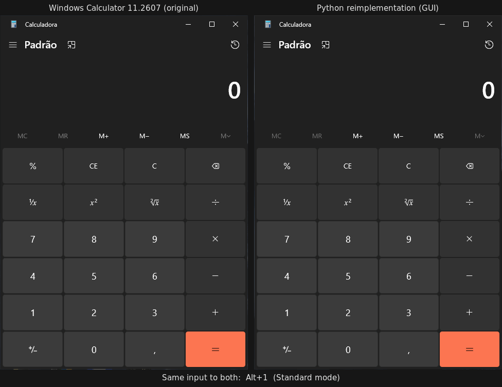
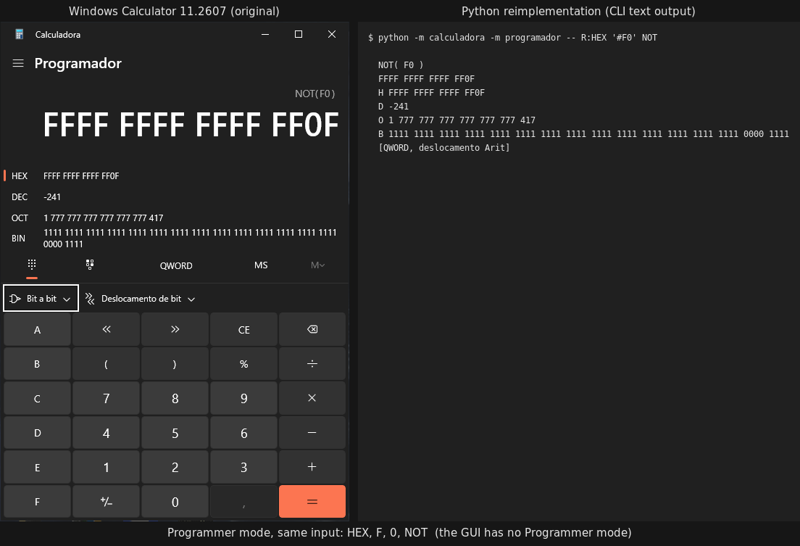

# Windows Calculator: static reverse engineering and a Python reimplementation

> Independent, educational project. It is not affiliated with, endorsed by or
> supported by Microsoft. "Windows" and "Windows Calculator" are trademarks of
> Microsoft Corporation. No Microsoft binaries, resources or source code are
> distributed in this repository. See [Disclaimer](#disclaimer-and-what-is-not-in-this-repository).

[Versão curta em português](README.pt-BR.md) · Reports are written in Portuguese (see [Documentation](#documentation)).

**Contents:** [Demo](#demo) · [Results at a glance](#results-at-a-glance) · [Overview](#overview) ·
[The experiment](#the-experiment-rea-inside-claude-code) · [What was found](#what-was-found-short-version) ·
[The reimplementation](#the-reimplementation) · [Running](#running) · [Results](#results) ·
[Known limitations](#known-limitations) · [Documentation](#documentation) ·
[Disclaimer](#disclaimer-and-what-is-not-in-this-repository)

## Demo



Left: the installed Windows Calculator 11.2607, driven as a black box. Right: the graphical
front end of the Python reimplementation. Both received the same input (`12 + 7 × 3 =`,
`1 ÷ 0 =`, then `2 + 3 × 4 =` and `30 sin` in Scientific mode), one after the other, and a
frame was captured from each after every step. No frame was edited or dropped. Per frame,
0.20% to 0.21% of the pixels differ ([`trabalho/demo/diferencas.txt`](trabalho/demo/diferencas.txt)):
about 90% of them are in the 1-pixel window border, the rest in the title-bar icon (59 pixels)
and three corner pixels of the `=` button. The display and the text match.

The graphical front end is **not** in this repository: it reproduces the original's visual design
and is kept out (see the [Disclaimer](#disclaimer-and-what-is-not-in-this-repository)). The published
package is the engine, the view model and a command-line interface. Programmer mode exists only in
those, so its comparison puts the original's window next to the CLI's text output:



The values match. The expression line differs in spacing (`NOT(F0)` against `NOT( F0 )`): its exact
spacing was never determined, and the comparisons ignore spaces (see [Known limitations](#known-limitations)).
Both images are produced by [`trabalho/demo/gerar-demo.sh`](trabalho/demo/gerar-demo.sh) from real
captures; that step needs the installed Calculator and the unpublished front end.

## Results at a glance

| Measurement | What it tests | Result |
|---|---|---:|
| Predictions of the static analysis against the real app, first comparison | Was the analysis right? 215 cases written and hashed **before** running the app | 209/215 (97%) |
| Reimplementation against the same frozen cases | Reproduction (in sample): the real results of these cases were known when the code was written and corrected | 215/215 |
| Differential test 2: 300 random key sequences, new seed, after the corrections | Out of sample: identical final display and error state | 293/300 (97.7%) |

None of these numbers proves full equivalence. The scientific cases do not tell the engine's own
numeric algorithms apart from exact arithmetic, three rules found by the last differential test
are still open, and several features are out of scope. Details are under [Results](#results) and
[Known limitations](#known-limitations).

## Overview

This repository documents an experiment: reverse engineering the Windows Calculator
(`Microsoft.WindowsCalculator` 11.2607.0.0, x64) **by static analysis only**, writing
down every finding with its evidence, freezing testable predictions *before* checking
them against the real application, and then reimplementing the calculator in Python
**from the written reports alone**.

The outcome is:

- a set of analysis reports (`relatorio/`) covering the package, its architecture, the
  calculation engine and four feature areas (standard operations, history and memory,
  scientific mode, programmer mode);
- 215 hand-written test cases plus 600 randomly generated key sequences whose
  predictions were hashed before execution and then compared with the real app;
- a Python package (`reimpl/calculadora`) that reproduces the standard, scientific and
  programmer modes, the display formatting, history and memory, with a CLI;
- a candid list of what could not be determined and why (`relatorio/04-lacunas.md`).

The project is **not complete**. Unit conversion, graphing, date calculation and the
engine's own arbitrary-precision algorithms were left out of scope, and a few behaviours
found by the last differential test are still open. See [Known limitations](#known-limitations).

## The experiment: REA inside Claude Code

The analysis was carried out in [Claude Code](https://claude.com/claude-code) sessions
using the **REA** reverse-engineering MCP server with its **Ghidra** provider (headless
decompilation, cross references, strings, evidence bundles). The author defined the
protocol, reviewed each phase and ran the black-box executions on Windows. The
protocol given to the agent is checked in as [`CLAUDE.md`](CLAUDE.md) (Portuguese). Its
rules shaped everything below:

| Rule | Why it matters |
|---|---|
| Static analysis only. The binaries are read-only and never executed. | Every claim is traceable to bytes, pseudocode, metadata or strings. |
| No consultation of the public `microsoft/calculator` repository or of any write-up about it. Only format documentation (PE, APPX, WinRT metadata, PRI, XBF) and tool documentation were allowed. | The reports describe what the binaries show, not what the source says. |
| Every statement is tagged **[O]** (observed: file, address, string, symbol or pseudocode) or **[I]** (inferred). | Readers can tell evidence from reasoning. The tags were later audited against the real results. |
| Predictions are frozen: the SHA-256 of each test-case file is recorded in `hashes-originais.txt` before any execution. Prediction columns never change afterwards. | Hit rates are honest. Divergences are investigated in the binary and logged, not patched over. |
| The installed Calculator may be driven only as a black box, through UI Automation, to collect real results. | Nothing observed at run time feeds back into frozen predictions. |
| The reimplementation is written from `relatorio/` only. | Measures whether the documentation is sufficient. One consultation of already-extracted pseudocode was needed during phase 5; it is logged as gap L29. |

Phases, in order: environment check (0), inventory (1), structural map (2), one feature
at a time with static analysis, frozen predictions, black-box run and comparison (3a to
3d), consolidated test cases (4) and reimplementation with tests (5). Two
out-of-sample differential tests were added after phase 5.

Tools recorded in the reports: Claude Code CLI 2.1.308, REA (`rea-agents` 6.7.0) with
Ghidra 12.1.4, Python standard-library parsers written for the project (PE/COFF, MSVC
RTTI, PRI, `.winmd`) and PowerShell with UI Automation for the black-box runs.

## What was found (short version)

Details and evidence are in `relatorio/00-inventario.md` and `relatorio/01-arquitetura.md`.

- `CalculatorApp.exe` is a 20 KB launcher that jumps into `CalculatorApp.dll`.
- `CalculatorApp.dll` holds the user interface: C# compiled ahead of time by .NET Native,
  with the XAML compiled to XBF inside `resources.pri`. Its managed metadata is not
  recoverable with the tools used, so this layer is known only by its observable effect.
- `CalcViewModel.dll` holds the view models (C++/CX WinRT runtime classes) **and** the
  calculation engine (the `CalcManager` component, statically linked C++ with
  arbitrary-precision rational arithmetic; the reports refer to it as "ratpak").
- The UI reaches the engine through WinRT activation: XAML bindings and a
  `ButtonPressed` command on `StandardCalculatorViewModel` lead to
  `CalculatorManager::SendCommand`, which dispatches to one of three engine instances
  (standard, scientific, programmer). Results come back through a display callback
  interface and property-change notifications.
- 558 WinRT methods of the view-model layer were tied to native addresses through the
  C++/CX ABI layout of the vtables, which compensates for the absence of PDB symbols.

## The reimplementation

`reimpl/calculadora` is a plain Python package (dependency: `mpmath`). Each module maps
to a component that the reports describe, and comments in the code cite the report
section and the binary address the rule came from.

| Module | Reproduces |
|---|---|
| `viewmodel.py` | `StandardCalculatorViewModel`: button dispatch, error state, HEX/DEC/OCT/BIN panel, button enable/disable rules |
| `gerenciador.py` | `CalculatorManager` and `CalculatorHistory`: command routing, inverse functions, one engine per mode, memory, 20-item history per mode |
| `motor.py` | the engine: command processing, binary and unary operations, operator precedence (scientific), parentheses, integer mode (programmer), error codes |
| `coletor.py` | the expression/history token collector |
| `entrada.py` | the number input object: digits, separator, backspace, sign, exponent, digit limits |
| `formatacao.py` | number-to-string: 16 and 32 significant digits, rounding, scientific notation, pt-BR grouping, F-E, binary padding |
| `numerico.py` | exact rationals (`fractions.Fraction`), domains and error codes; transcendental functions through `mpmath` (see limitations) |
| `textos.py` | engine symbol and error-message tables and the per-command text rules |
| `cli.py`, `teclas.py` | command-line interface and key notation |

## Repository layout

```
CLAUDE.md                  protocol given to the agent (Portuguese)
hashes-originais.txt       SHA-256 of the analysed binaries and of every frozen test-case file
relatorio/                 analysis reports (Portuguese)
  00-inventario.md         package inventory, integrity checks, which binary holds what
  01-arquitetura.md        imports, RTTI, vtables, WinRT types, UI -> view model -> engine chain
  02-features/*.md         per-feature analysis, each ending with the black-box results
  03*-casos-de-teste.md    frozen test cases with predictions (hashed before execution)
  03-diferencial-*         out-of-sample differential tests (random key sequences) and results
  resultados-reais*.txt    what the real Calculator did, read through UI Automation
  04-lacunas.md            gaps: what could not be determined and why
  99-conclusao.md          summary, hit rates and lessons on method
reimpl/                    Python reimplementation and tests
  calculadora/             engine, view model, formatting, CLI
  tests/                   oracle built from the frozen cases and the real results
  ferramentas/             case extractor, mutation harness
  README.md                technical notes on the reimplementation (Portuguese)
docs/assets/               demo images used in this README
trabalho/                  working files: parsers (PE, RTTI, PRI, winmd), UI Automation
                           scripts, logs and notes.
                           Artefacts extracted from the Microsoft binaries are git-ignored.
  demo/                    script that captures both calculators and builds the demo images
```

## Running

Requirements: Python 3.10 or newer and `mpmath`. `pytest` for the tests. The CLI and
the test suite are pure Python and were verified on WSL2 (Ubuntu, Python 3.12.3).

```sh
cd reimpl
python3 -m venv .venv
.venv/bin/pip install -e '.[testes]'        # or: .venv/bin/pip install mpmath pytest
```

### Command line

Keys are given as arguments. A multi-digit number means one button per digit, `#F0`
enters hexadecimal digits, `R:HEX` selects a radix, and `÷ × − √ x² 1/x` are accepted
as aliases. Without arguments the CLI is interactive and `:ajuda` lists the keys. The
display follows the pt-BR conventions of the analysed installation (decimal comma,
thousands separator, Portuguese error messages); `--idioma en-US` switches only the
error messages, because the real app keeps the engine symbols in English (gap L17).

```sh
.venv/bin/python -m calculadora 2 + 3 '*' 4 =
#   5   ×   4 =
#   20
# histórico:
#   5   ×   4 = | 20
#   2   +   3 = | 5
```

Standard mode has no operator precedence and an implicit `=` when the operator changes,
hence the two history entries. Other examples:

```sh
.venv/bin/python -m calculadora -m cientifico 30 SIN            # sin₀( 30 ) -> 0,5 [DEG]
.venv/bin/python -m calculadora -m programador -- R:HEX '#F0' NOT  # NOT( F0 ) -> FFFF FFFF FFFF FF0F
.venv/bin/python -m calculadora 1 / 0 =                          # Não é possível dividir por zero
```

### Tests

```sh
cd reimpl
.venv/bin/python -m pytest
```

The suite has 220 tests:

- **215 frozen cases** (`tests/test_casos.py`): one test per case from the four frozen
  files. A test passes only if every reading that the automation recorded for that case
  matches: display, history text, memory, button enabled states, programmer panel lines,
  bit grid and the transcribed expression line.
- **5 integrity tests** (`tests/test_congelados.py`): the SHA-256 of each frozen file
  still matches `hashes-originais.txt`, the case IDs match `tests/casos.json`, and the
  initial button state matches the real app.

A negative check of the harness is also provided: `ferramentas/mutacoes.py` breaks one
documented rule at a time (rounding, binary padding, modulo sign, thousands grouping,
disabled-button handling, small-value cut-off) and verifies that each mutation makes
frozen cases fail.

```sh
.venv/bin/python ferramentas/mutacoes.py
```

## Results

All figures below were measured in this project. Sources: `relatorio/99-conclusao.md`,
the results sections of `relatorio/02-features/*.md` and
`relatorio/03-diferencial-resultados.md`. Rates are first-pass rates: the comparison was run
once against the frozen predictions, and re-runs are logged separately.

### Predictions of the static analysis versus the real application

| Feature block | Frozen cases | Correct on first pass |
|---|---:|---:|
| Standard operations and division by zero (3a) | 30 | 27 |
| History and memory (3b) | 27 | 26 |
| Scientific mode (3c) | 73 | 73 |
| Programmer mode (3d) | 85 | 83 |
| **Total** | **215** | **209 (97%)** |

Notes recorded in the reports: in 3a all 54 display readings matched and the three
misses were in the expression line, which had been tagged as inferred; in 3c, the 26
32-digit values of block B do not discriminate the engine's algorithm from exact
arithmetic, so they confirm the display rules but not the numerics.

### Reimplementation versus the frozen cases

215 of 215 frozen cases pass (`pytest`, 220 tests, Python 3.12.3 on WSL2, 2026-10-23).
This is a reproduction measurement, not a prediction: five rules were corrected in the
reports and the code after the first differential test, using those same results.

### Out-of-sample differential tests

Each run uses 300 random key sequences (100 per mode, fixed seed, hashed before
execution). Criterion: identical final display and identical error state.

| Run | Standard | Scientific | Programmer | Total |
|---|---:|---:|---:|---:|
| Differential 1, before any correction | 100/100 | 58/100 ¹ | 87/100 | 245/300 (81.7%) |
| Differential 2, after the corrections, new seed | 98/100 | 96/100 | 99/100 | **293/300 (97.7%)** |

¹ 39 scientific cases were invalidated by state contamination in the automation (an
F-E toggle pressed while in error); on the valid ones the rate was 58/61. Of the 7
remaining divergences in differential 2, 5 are documentation gaps (three open rules,
see below) and 2 are automation failures; none was attributed to the numeric engine.

## Known limitations

**Scientific mode** (the least complete part):

- The engine's own numeric algorithms were **not** emulated. The original computes
  transcendental functions with its arbitrary-precision library (a 41-digit π, Taylor
  series and its own gamma function). The reimplementation evaluates them with `mpmath`
  at 120 digits and rounds to exact rationals, then applies the rules read from the
  binary that change the visible result (angle reduction, domain checks, the
  small-value cut-off, overflow limits). Every test case so far agrees, but the audit in
  `relatorio/02-features/c-cientifico.md` §10.2 shows that no case discriminates the two
  approaches. Last-digit differences on other inputs are possible.
- `DMS`, `Degrees` and `Rand` are not implemented.
- `sec`/`csc`/`cot`, the inverse hyperbolic functions, `0^0`, rounding when the
  exponent is positive and the value exceeds the digit limit, and the size limit of
  exact rationals are decisions the reports do not cover (gap L31). They are marked
  `[I]` in the code.
- Three rules found by differential 2 are documented but not yet implemented
  (`relatorio/99-conclusao.md` §4): `%` after a bare `=`, repeated `=` after precedence
  unstacking, and `C` while F-E is on.
- The expression line is reproduced token by token; its exact spacing in the original
  is inferred, and comparisons ignore spaces.

**General:**

- Out of scope by decision: unit and currency conversion, graphing mode, date
  calculation.
- Not implemented: paste, in-place editing of expression tokens, clicking a history
  item to reload it, per-item memory buttons.
- The C# layer of `CalculatorApp.dll` was never read. Mode switching, the F-E toggle
  reaction and which code applies the error visual states are known only by effect.
- The analysed installation is pt-BR Windows. Other locales were not analysed.

The full list, with status and reasons, is `relatorio/04-lacunas.md` (36 items).

## Documentation

All reports are in Portuguese.

| File | Content |
|---|---|
| [`relatorio/00-inventario.md`](relatorio/00-inventario.md) | package inventory, integrity (block map, signature chain), engine and UI location with evidence |
| [`relatorio/01-arquitetura.md`](relatorio/01-arquitetura.md) | imports/exports, RTTI class hierarchy, vtables, WinRT types, module and communication map |
| [`relatorio/02-features/a-operacoes-basicas.md`](relatorio/02-features/a-operacoes-basicas.md) | standard operations, error handling, display formatting |
| [`relatorio/02-features/b-historico-memoria.md`](relatorio/02-features/b-historico-memoria.md) | history and memory |
| [`relatorio/02-features/c-cientifico.md`](relatorio/02-features/c-cientifico.md) | scientific mode: functions, angle units, precedence, parentheses, 32-digit display |
| [`relatorio/02-features/d-programador.md`](relatorio/02-features/d-programador.md) | programmer mode: radixes, word sizes, bitwise operations, shifts and rotations |
| [`relatorio/03-casos-de-teste.md`](relatorio/03-casos-de-teste.md), `03b`, `03c`, `03d` | frozen test cases and predictions |
| [`relatorio/03-diferencial-resultados.md`](relatorio/03-diferencial-resultados.md) | differential tests: method, rates, classified divergences |
| [`relatorio/04-lacunas.md`](relatorio/04-lacunas.md) | gaps and their status |
| [`relatorio/99-conclusao.md`](relatorio/99-conclusao.md) | summary, evolution of the rates, lessons on method |
| [`reimpl/README.md`](reimpl/README.md) | module-by-module notes, oracle design, undocumented decisions |
| [`trabalho/pri/LEIAME.md`](trabalho/pri/LEIAME.md) | PRI and XBF parsing notes |

## Disclaimer and what is not in this repository

- This is an independent educational project with no affiliation to Microsoft. It is
  not endorsed by or associated with Microsoft Corporation.
- The analysed binaries (`binarios/`, `binarios-ptbr/`) are proprietary and are **not**
  included. Only their SHA-256 hashes are, in `hashes-originais.txt`, so that the
  analysis can be tied to exact files.
- Working artefacts derived from those binaries (decompiled pseudocode, extracted
  strings and resources, compiled XAML, screenshots of the original application) are
  excluded through `.gitignore`. The reports quote short excerpts of pseudocode and
  strings where needed as evidence.
- The one exception is `docs/assets/`: the demo images contain screen captures of the
  installed Calculator, published deliberately to show the comparison. They are pictures
  of the running application, not content extracted from the binaries. The graphical
  front end of the reimplementation shown next to them reproduces the original's visual
  design and is not published.
- The XBF (compiled XAML) extractor used during the analysis is not published either:
  part of it is ported from an Apache-2.0 project and its type table derives from the
  Windows SDK. Because of these exclusions, some file paths cited inside the reports
  point to files that are not in the repository.
- The reimplementation was written from the reports in this repository. The public
  source code of the Windows Calculator was deliberately not consulted at any point, as
  required by the protocol in `CLAUDE.md`.
- The project is not complete and the measurements above are specific to the analysed
  version (11.2607.0.0) and installation (pt-BR, Windows 10, 96 DPI).

## License

Code and documentation in this repository are released under the [MIT License](LICENSE).
The license covers only the contents of this repository. The analysed Microsoft binaries,
and any artefacts derived from them, are not included in this repository and are not
covered by this license (see the Disclaimer above).
